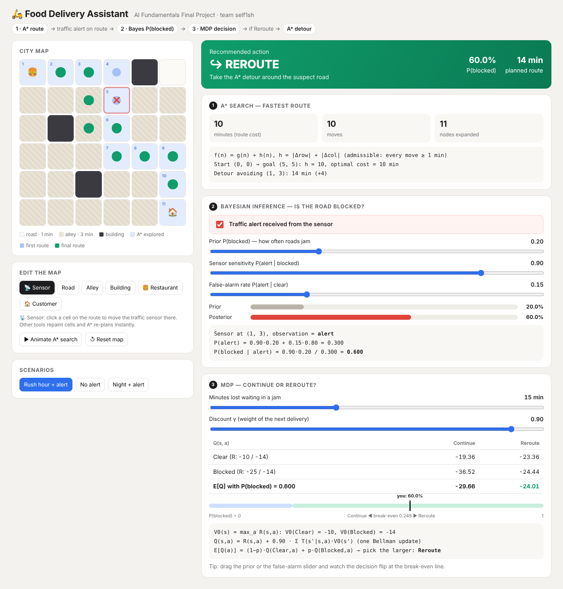

# 🛵 Food Delivery Assistant
**AI Fundamentals: Final Project** · Team **self1sh** · Amantaev Islam (solo)

A courier delivers food across a small city map. Partway along the route, a traffic sensor raises an alert, and the sensor can be wrong. The assistant decides whether to **continue** or **reroute** by combining three AI methods from the course:

| # | AI topic | Algorithm | Question it answers |
|---|---|---|---|
| 1 | Search | **A\*** (weighted grid, Manhattan heuristic) | What is the fastest route? |
| 2 | Probabilistic reasoning | **Bayesian inference** | How likely is the road to be blocked, given a noisy sensor? |
| 3 | Sequential decision making | **MDP** (Bellman update + belief-weighted Q) | Should the courier continue or take the detour? |



## Quick start
Python 3.8+ only. **No packages to install.**

```bash
python3 app.py                         # web UI → opens http://localhost:8000
python3 delivery_assistant.py          # console demo (alert received)
python3 delivery_assistant.py --no-alert
python3 delivery_assistant.py --prior 0.03
python3 -m unittest -v                 # 20 tests
```
On Windows use `python` or `py` instead of `python3`.

## How the three algorithms work together
```
 A* route ──► alert on a route cell ──► Bayes: P(Blocked) ──► MDP: Continue / Reroute
    ▲                                                              │
    └──────────── A* again, suspect cell avoided ◄─── if Reroute ──┘
```
Each step uses the output of the step before it:
- Bayes tests a cell **on the route that A\* chose**.
- The MDP rewards are **the route costs from A\***: 10 min for the main route, 14 min for the detour.
- The MDP belief is **the Bayes posterior**.
- If the decision is Reroute, the plan **goes back to A\*** and is replanned without that cell.

## Web UI
- **Map editor:** paint roads, alleys and buildings, or move the restaurant and the customer. A\* replans immediately.
- **📡 Sensor tool:** click any cell on the route to move the traffic sensor there.
- **Sliders:** prior, sensor sensitivity, false-alarm rate, jam penalty and γ. Every formula on the page updates live.
- **Break-even bar:** shows the probability where the decision flips, with a marker for the current posterior.
- **▶ Animate A\*:** replays the order in which A\* expanded the nodes.
- **Scenarios:** Rush hour + alert, No alert, Night + alert.

## Map and assumptions (hypothetical values)
```
S . . . # .     S  restaurant (0,0)     .  main road, 1 min
~ ~ ~ . ~ ~     C  customer   (5,5)     ~  back alley, 3 min
~ # ~ . ~ ~                             #  building (impassable)
~ ~ ~ . . .
~ ~ # ~ ~ .
~ ~ ~ ~ ~ C
```
| Parameter | Value | Meaning |
|---|---|---|
| P(Blocked) prior | 0.20 | rush-hour jam rate |
| P(alert \| Blocked) | 0.90 | sensor sensitivity |
| P(alert \| Clear) | 0.15 | false-alarm rate |
| Jam wait | 15 min | penalty for driving into a jam |
| γ | 0.9 | weight of the next delivery |

## 1. A* search
- **Input:** the map, S, C and the cell costs.
- **Steps:** always expand the node with the lowest f = g + h, where g is the minutes so far and h is the Manhattan distance to C. h is **admissible** because every move costs at least 1 minute, so A\* returns the optimal route.
- **Output:** `(0,0)→(0,1)→(0,2)→(0,3)→(1,3)→(2,3)→(3,3)→(3,4)→(3,5)→(4,5)→(5,5)`, **10 min**, 11 nodes expanded.
- **Why A\*:** the cells have different costs. BFS minimises the number of moves, not the number of minutes. Dijkstra would find the same route but has no heuristic to guide it, so it expands more nodes.

## 2. Bayesian inference
- **Input:** an alert on route cell (1,3), with prior 0.20.
- **Steps:**
  - P(alert) = 0.90·0.20 + 0.15·0.80 = 0.30
  - P(B | alert) = 0.18 / 0.30 = **0.60**
- **Output:** 60% blocked. With no alert the posterior drops to 2.9%.
- **Why Bayes:** the sensor is noisy, and jams are rare. One alert should move the belief, not settle it.

## 3. MDP
- **States:** Clear, Blocked. **Actions:** Continue, Reroute.
- **Rewards:** R = −minutes. Continue costs −10 if Clear and −25 if Blocked. Reroute costs −14.
- **Transitions:** T is the road state at the next delivery. A jam you drive into tends to persist (0.7). Rerouting lets it clear (0.4).
- **One Bellman update:** start from V₀(s) = max_a R(s,a). Then Q(s,a) = R(s,a) + γ Σ T(s'|s,a) V₀(s').

| Q(s,a) | Continue | Reroute |
|---|---|---|
| Clear | −19.36 | −23.36 |
| Blocked | −36.52 | −24.44 |
| **E[Q] at p = 0.60** | −29.66 | **−24.01** |

- **Output:** **REROUTE**. The break-even point is P(Blocked) = **0.249**.
- **Why an MDP:** a probability alone does not choose an action. The MDP combines the uncertainty, the cost of a wrong choice and the effect on the next delivery.

## Results
| Scenario | P(Blocked) | Action | Route |
|---|---|---|---|
| Rush hour + alert (prior 0.20) | 0.600 | Reroute | 14 min detour |
| No alert (prior 0.20) | 0.029 | Continue | 10 min |
| Night + alert (prior 0.03) | 0.157 | Continue | 10 min |

The same alert leads to different decisions depending on the context. The system reasons about the evidence instead of following a fixed rule ("alert → reroute").

## Testing
`test_delivery.py` has 20 unit tests:
- A\*: optimal cost, walls, detours, unreachable goal.
- Bayes: hand-computed posteriors, normalisation.
- MDP: hand-computed Bellman values, extreme beliefs, break-even.
- End-to-end scenarios.
- Edge cases: no detour, sensor placement, bad maps.
- The web API.

## Project structure
```
delivery_assistant.py   core: A*, Bayes, MDP, pipeline + console demo
app.py                  web server (stdlib http.server) + JSON API
static/index.html       web UI
test_delivery.py        unit tests
docs/                   screenshots
AI_USAGE.md             AI usage declaration
CONTRIBUTION.md         team contribution statement
```

## Limitations and future work
- Only one suspect cell and one sensor reading. Next step: several sensors and several cells.
- A static snapshot of traffic. An **HMM** could track how a jam evolves over time.
- Probabilities are assumed, not measured. They could be learned from historical delivery data.
- The toy grid could be replaced by a real street graph (OpenStreetMap) with live traffic.
- Several couriers and orders lead to an assignment problem and multi-agent planning.
